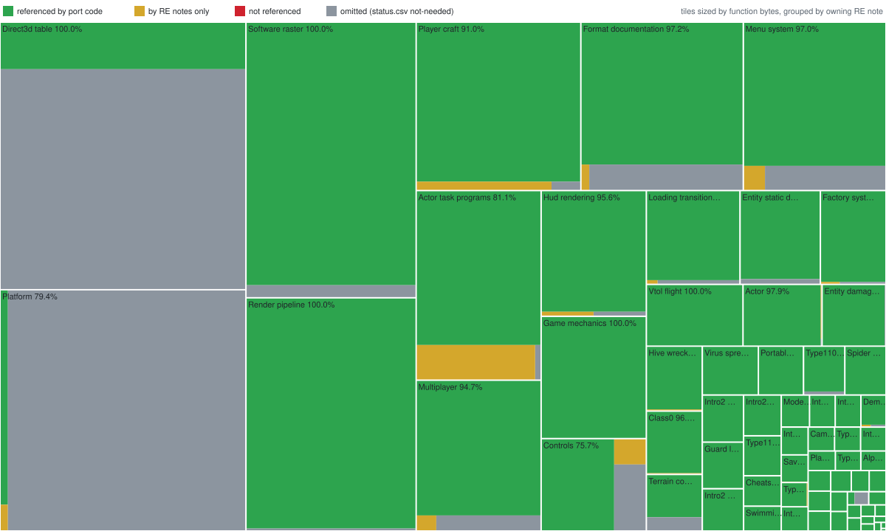

# Reverse-engineering progress

> Generated by `scripts/progress.ps1`. Do not edit by hand.

OpenV2K is a reimplementation, not a matching decompilation. Nothing is
recompiled into the original binary, so there's no byte-exact "percent
decompiled". Instead, this report counts which retail functions the port's code
and RE notes cite by address (for example `FUN_0042D030`).

| Measure | Functions | Share |
|---|---:|---:|
| Game functions in retail `V2000.EXE` | 2,399 | |
| Marked not needed (excluded below) | 628 | |
| **Referenced by port code** | **1,679** | **94.8%** |
| Referenced by code or RE notes | 1,771 | 100.0% |
| Library functions (CRT, DirectX stubs; not counted) | 408 | |

Manual statuses from [`status.csv`](status.csv):

| Status | Functions |
|---|---:|
| implemented | 444 |
| approximated | 8 |
| documented | 30 |
| not-needed | 628 |

10 `FUN_` citations don't match a retail function
start. Run `scripts/progress.ps1 -ListUnresolved` to list them.

## Map

Each rectangle is the RE note that cites its functions most often, sized by
their bytes and split by state; its label gives the share of its functions the
port's code references. A function only catalog notes cite (small functions,
the Infestation cross-reference, the fidelity-gap list) joins its nearest
neighbour's note.

Where the code's references are thinnest:

| Note | Not referenced by code | Of them, its neighbours | Referenced |
|---|---:|---:|---:|
| [Actor task programs](../re/ACTOR_TASK_PROGRAMS.md) | 23 | 3 | 99 |
| [Controls](../re/CONTROLS.md) | 17 | 1 | 53 |
| [Player craft](../re/PLAYER_CRAFT.md) | 15 | 0 | 119 |
| [Multiplayer](../re/MULTIPLAYER.md) | 8 | 0 | 144 |
| [Platform](../re/PLATFORM_RUNTIME.md) | 7 | 0 | 27 |
| [Menu system](../re/MENU_SYSTEM.md) | 5 | 1 | 157 |
| [Format documentation](../re/FORMAT_DOCUMENTATION.md) | 4 | 0 | 140 |
| [Loading transitions](../re/LOADING_TRANSITIONS.md) | 4 | 1 | 56 |
| [Hud rendering](../re/HUD_RENDERING.md) | 2 | 1 | 43 |
| [Actor](../re/ACTOR_RUNTIME.md) | 1 | 0 | 47 |

## Omitted

Functions marked `not-needed` in [`status.csv`](status.csv) leave the
denominator, each with its reason: the never-installed
[Direct3D table](../re/DIRECT3D_TABLE.md), FGDK
[module glue](../re/PLATFORM_RUNTIME.md#modules), the platform layer
[the port replaces](../re/PLATFORM_RUNTIME.md#what-the-port-replaces) and
[census entries that are not routines](../re/SMALL_FUNCTIONS.md#census-artifacts):

| Reason | Functions |
|---|---:|
| glue: an FGDK module's open or close thunk (docs/re/PLATFORM_RUNTIME.md#modules) | 154 |
| replaced: the port's SDL platform (the DirectDraw screen device, its buffers and texture pages; docs/re/PLATFORM_RUNTIME.md#what-the-port-replaces) | 96 |
| dead: retail's Direct3D fill table, never installed (every display mode selects the software table; docs/re/DIRECT3D_TABLE.md) | 59 |
| replaced: Rust ownership (module open and close, and module or table setup that only clears state, starts lists, adds or drops hooks or frees records; docs/re/PLATFORM_RUNTIME.md#what-the-port-replaces) | 56 |
| replaced: the port's game states (FGDK applications, modes and mode slots, their chains and binding sets, and the records a mode allocates and frees; docs/re/PLATFORM_RUNTIME.md#what-the-port-replaces) | 30 |
| replaced: the port's SDL platform (FGDK's input binding layer: device input states, binding records, value records and the event ring; docs/re/PLATFORM_RUNTIME.md#what-the-port-replaces) | 24 |
| not a routine: padding, a jump table's alignment or a split-off part of the function before it (docs/re/SMALL_FUNCTIONS.md#census-artifacts) | 22 |
| replaced: the port's SDL platform (the keyboard, mouse and joystick readers and their device lists; docs/re/PLATFORM_RUNTIME.md#what-the-port-replaces) | 21 |
| replaced: the port's SDL platform (the window, its pump and main loop, multimedia timers and file reads; docs/re/PLATFORM_RUNTIME.md#what-the-port-replaces) | 21 |
| replaced: the port's SDL platform (MCI CD audio, the message box, the command line; docs/re/PLATFORM_RUNTIME.md#what-the-port-replaces) | 18 |
| replaced: Rust errors (FGDK error objects, fatal reports, cleanup scopes and scoped allocation; docs/re/PLATFORM_RUNTIME.md#what-the-port-replaces) | 17 |
| dead: collision register op 0x36 table 0x004D4980; no shipped collision program uses 0x36 (docs/re/FORMAT_DOCUMENTATION.md) | 16 |
| replaced: the port's AVI decoder and SDL audio (the DirectShow banner movie and the DirectSound voices; docs/re/PLATFORM_RUNTIME.md#what-the-port-replaces) | 16 |
| dead: the attract sheet mode 004C9840 (its draw chain and key table 004C9810), which FUN_00426F00 never stages because its gate FUN_00438050 always returns 0 (docs/re/MENU_SYSTEM.md) | 12 |
| replaced: the port's fixed RGB565 surfaces (pixel-format listeners and the unpacking a mode change runs; docs/re/PLATFORM_RUNTIME.md#what-the-port-replaces) | 7 |
| dead: installed at Graph2D +0x1068..+0x107C by FUN_00480D10, but no queue thunk or call site reads those slots (docs/re/SOFTWARE_RASTER.md) | 6 |
| dead: only in the default game-channel descriptor 004D4A00, which FUN_0046BED0 uses when its caller passes none; both callers (FUN_0046CAC0, FUN_0046CB50) pass the game's 004CAFA8 (docs/re/MULTIPLAYER.md#player-slots) | 4 |
| dead: stored in software fill slots +0x10B0..+0x10BC, which no thunk or call site calls (docs/re/SOFTWARE_RASTER.md) | 4 |
| dead: no Section-12 type selects class 52 (Lightning Shield) as a behavior or alternate (docs/re/PLAYER_CRAFT.md#special-weapons) | 3 |
| dead: no shipped model vertex has type 10 (docs/re/FORMAT_DOCUMENTATION.md) | 3 |
| dead: no shipped model vertex has type 4 (docs/re/FORMAT_DOCUMENTATION.md) | 3 |
| dead: only in the value-op table 0x004CDF08, which no code or data references (docs/re/FORMAT_DOCUMENTATION.md) | 3 |
| replaced: the port's UDP transport (DirectPlay 3's connection enumeration; docs/re/MULTIPLAYER.md#the-port) | 3 |
| dead: sea table 0x004C92B8 is installed by FUN_004129B0 but never walked (docs/re/TERRAIN_COLLISION.md) | 2 |
| replaced: the port's SDL platform (the debug log file, debugger output and fatal-error exit; docs/re/PLATFORM_RUNTIME.md#what-the-port-replaces) | 2 |
| dead: its body runs only when the load-progress callback DAT_004F7310 is set, which nothing writes (FUN_00433BD0 and FUN_0044AB20 call it to no effect) | 1 |
| dead: only stored as the first word of the FUN_00433130 render request at 0x004DB250, which no code reads or calls | 1 |
| dead: projector-table slot +0xBC of 0x004D4A78, which no instruction calls (docs/re/FORMAT_DOCUMENTATION.md) | 1 |
| dead: projector-table slot +0xC8 of 0x004D4A78, which no instruction calls (docs/re/FORMAT_DOCUMENTATION.md) | 1 |
| dead: stored in software fill slot +0x101C, which no thunk or call site calls (docs/re/SOFTWARE_RASTER.md) | 1 |
| dead: the module's default callback for the full-frame request (004DB250), which FUN_00433130 copies but nothing ever calls | 1 |
| dead: the undefined model opcode trap, an endless loop; no shipped model stream holds an undefined opcode (docs/re/FORMAT_DOCUMENTATION.md) | 1 |
| no effect: its only caller FUN_0042B870 passes the word it reads to FUN_0040F350, which ignores that argument (docs/re/SMALL_FUNCTIONS.md) | 1 |
| no effect: the common type vtable's removal hook (FUN_004149F0) calls entity +0xC4 only when it is set, and nothing writes that field (docs/re/SMALL_FUNCTIONS.md) | 1 |
| Queen aiming line; its caller's flag DAT_004DB0B8 is never written (docs/re/TYPE110_QUEEN.md) | 1 |
| replaced: the port's file saves (the save device's status, which the PC build always reports ready; docs/re/PLATFORM_RUNTIME.md#what-the-port-replaces) | 1 |
| replaced: the port's UDP transport (DirectPlay 3's COM and event setup; docs/re/MULTIPLAYER.md#the-port) | 1 |
| replaced: the port's UDP transport (DirectPlay 3's COM and event teardown; docs/re/MULTIPLAYER.md#the-port) | 1 |
| replaced: the port's UDP transport (DirectPlay 3's connection initialization; docs/re/MULTIPLAYER.md#the-port) | 1 |
| replaced: the port's UDP transport (DirectPlay 3's enumeration buffers; docs/re/MULTIPLAYER.md#the-port) | 1 |
| replaced: the port's UDP transport (DirectPlay 3's lobby launch; docs/re/MULTIPLAYER.md#the-port) | 1 |
| replaced: the port's UDP transport (DirectPlay 3's object creation; docs/re/MULTIPLAYER.md#the-port) | 1 |
| replaced: the port's UDP transport (DirectPlay 3's receive calls; docs/re/MULTIPLAYER.md#the-port) | 1 |
| replaced: the port's UDP transport (DirectPlay 3's receive thread; docs/re/MULTIPLAYER.md#the-port) | 1 |
| replaced: the port's UDP transport (DirectPlay 3's send call; docs/re/MULTIPLAYER.md#the-port) | 1 |
| replaced: the port's UDP transport (DirectPlay 3's session close; docs/re/MULTIPLAYER.md#the-port) | 1 |
| replaced: the port's UDP transport (DirectPlay 3's session creation; docs/re/MULTIPLAYER.md#the-port) | 1 |
| replaced: the port's UDP transport (DirectPlay 3's session enumeration; docs/re/MULTIPLAYER.md#the-port) | 1 |
| replaced: the port's UDP transport (DirectPlay 3's session join; docs/re/MULTIPLAYER.md#the-port) | 1 |
| replaced: the port's UDP transport (DirectPlay 3's session reset; docs/re/MULTIPLAYER.md#the-port) | 1 |
| WinMain: protection-library start and stop around the engine main; the port has its own entry point | 1 |

## Method

- [`retail-functions.csv`](retail-functions.csv) lists every function start in
  the retail executable. It comes from a Ghidra census that combines
  auto-analysis with seeding from callback tables, already-cited addresses and
  uncovered code gaps, plus a few handlers seeded by hand. Functions
  cover 96% of `.text`, and most of the rest is padding. Everything from the
  first linker-placed library import stub (`0x004AC5A0`) onward counts as
  library code.
- A function counts as *referenced* when a Rust source file under `crates/`
  (for code) or a note under `docs/re/` cites its start address. A citation
  means the port or the notes deal with that function. It doesn't prove that
  every behavior of the function is reproduced. Addresses in the demo
  executable are written `DEMO_0040C6C0`, which the count skips.
- `status.csv` records judgments the citation count can't make:
  `implemented`, `approximated`, `documented` and `not-needed`.
  `not-needed` removes a function from the denominator, for example code
  retail never runs or the platform code SDL replaces.
- The numbers are regenerated on every commit by the `.githooks/pre-commit`
  hook. `scripts/check.ps1` runs `scripts/progress.ps1 -Check` and fails if they are stale.
