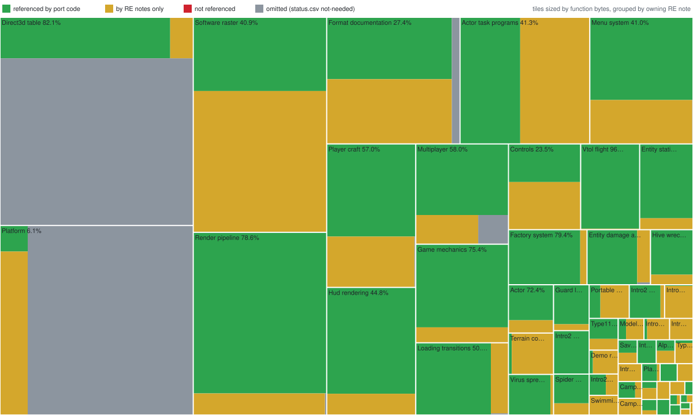

# Reverse-engineering progress

> Generated by `scripts/progress.ps1`. Do not edit by hand.

OpenV2K is a reimplementation, not a matching decompilation. Nothing is
recompiled into the original binary, so there's no byte-exact "percent
decompiled". Instead, this report counts which retail functions the port's code
and RE notes cite by address (for example `FUN_0042D030`).

| Measure | Functions | Share |
|---|---:|---:|
| Game functions in retail `V2000.EXE` | 2,383 | |
| Marked not needed (excluded below) | 1 | |
| **Referenced by port code** | **901** | **37.8%** |
| Referenced by code or RE notes | 2,075 | 87.1% |
| Library functions (CRT, DirectX stubs; not counted) | 408 | |

Manual statuses from [`status.csv`](status.csv):

| Status | Functions |
|---|---:|
| implemented | 202 |
| approximated | 6 |
| documented | 1 |
| not-needed | 1 |

87 `FUN_` citations don't match a retail function
start. Run `scripts/progress.ps1 -ListUnresolved` to list them.

## Map

Each rectangle is the RE note that cites its functions most often, sized by
their bytes and split by state; its label gives the share of its functions the
port's code references. A function only catalog notes cite (small functions,
the Infestation cross-reference, the fidelity-gap list) joins its nearest
neighbour's note.

Where the code's references are thinnest:

| Note | Not referenced by code | Of them, its neighbours | Referenced |
|---|---:|---:|---:|
| [Platform](../re/PLATFORM_RUNTIME.md) | 458 | 76 | 12 |
| [Format documentation](../re/FORMAT_DOCUMENTATION.md) | 122 | 25 | 43 |
| [Menu system](../re/MENU_SYSTEM.md) | 111 | 69 | 76 |
| [Software raster](../re/SOFTWARE_RASTER.md) | 83 | 4 | 54 |
| [Multiplayer](../re/MULTIPLAYER.md) | 75 | 16 | 2 |
| [Controls](../re/CONTROLS.md) | 69 | 31 | 21 |
| [Direct3d table](../re/DIRECT3D_TABLE.md) | 58 | 8 | 31 |
| [Loading transitions](../re/LOADING_TRANSITIONS.md) | 55 | 28 | 39 |
| [Hud rendering](../re/HUD_RENDERING.md) | 48 | 38 | 31 |
| [Render pipeline](../re/RENDER_PIPELINE.md) | 48 | 34 | 112 |

## Omitted

Functions marked `not-needed` in [`status.csv`](status.csv) leave the
denominator:

| Reason | Functions |
|---|---:|
| WinMain: protection-library start and stop around the engine main; the port has its own entry point | 1 |

## Method

- [`retail-functions.csv`](retail-functions.csv) lists every function start in
  the retail executable. It comes from a Ghidra census that combines
  auto-analysis with seeding from callback tables, already-cited addresses and
  uncovered code gaps. Functions cover 94% of `.text`, and most of the rest is
  padding. Everything from the first linker-placed library import stub
  (`0x004AC5A0`) onward counts as library code.
- A function counts as *referenced* when a Rust source file under `crates/`
  (for code) or a note under `docs/re/` cites its start address. A citation
  means the port or the notes deal with that function. It doesn't prove that
  every behavior of the function is reproduced.
- `status.csv` records judgments the citation count can't make:
  `implemented`, `approximated`, `documented` and `not-needed`.
  `not-needed` removes a function from the denominator, for example
  DirectPlay networking or debug-only paths.
- The numbers are regenerated on every commit by the `.githooks/pre-commit`
  hook. `scripts/check.ps1` runs `scripts/progress.ps1 -Check` and fails if they are stale.
